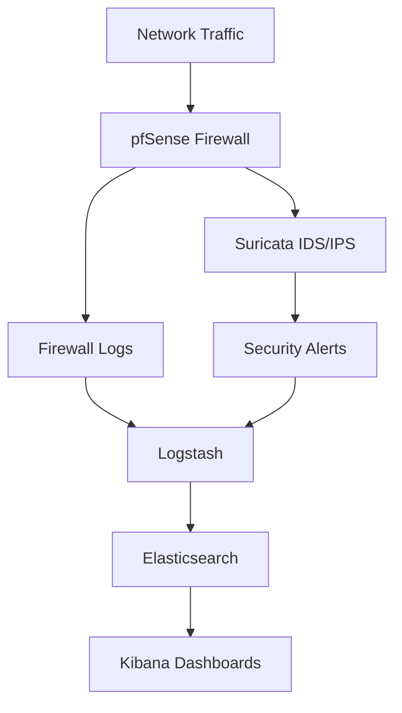

# Network Security and Monitoring Architecture

This diagram illustrates the logical architecture of the internship project.

## Components

- **pfSense:** Firewall and network traffic filtering.
- **Suricata:** Network intrusion detection and prevention.
- **Logstash:** Log collection and processing.
- **Elasticsearch:** Event indexing and storage.
- **Kibana:** Log visualization and analysis.

*The diagram represents the logical architecture. Actual log flows depend on the integration configured during the internship.*
